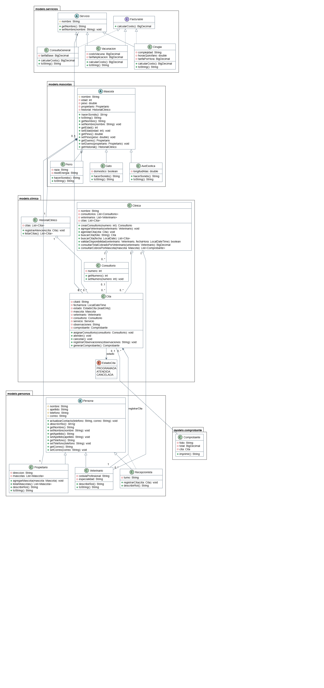

# PetCare

Sistema de gestión para una clínica veterinaria desarrollado en **Java** con un enfoque en **análisis y diseño orientado a objetos**. Administra propietarios, mascotas, veterinarios, consultorios, citas y servicios, y genera comprobantes de cobro con consultas de ingresos.

---

## Tabla de contenido

- [Características](#-características)
- [Tecnologías](#-tecnologías)
- [Arquitectura y paquetes](#-arquitectura-y-paquetes)
- [Diagrama de clases](#-diagrama-de-clases)
- [Conceptos de POO aplicados](#-conceptos-de-poo-aplicados)
- [Relaciones entre clases](#-relaciones-entre-clases)
- [Decisiones de diseño](#-decisiones-de-diseño)
- [Instalación y ejecución](#-instalación-y-ejecución)
- [Ejemplo de uso](#-ejemplo-de-uso)
- [Mejoras futuras](#-mejoras-futuras)
- [Autor](#-autor)

---

## Características

- Registro de **propietarios** y sus **mascotas** (perros, gatos y aves exóticas).
- Gestión de **veterinarios**, **recepcionistas** y **consultorios**.
- **Agenda de citas** con validación de disponibilidad del veterinario.
- Ciclo de vida de la cita mediante estados: `PROGRAMADA`, `ATENDIDA`, `CANCELADA`.
- **Servicios** con cálculo de costo propio: consulta general, vacunación y cirugía.
- **Historial clínico** por mascota.
- Generación de **comprobantes** de cobro.
- Consultas de cobros por **veterinario** y por **mascota**.

## Tecnologías

| Herramienta | Uso |
|---|---|
| Java | Lenguaje principal |
| `BigDecimal` | Manejo preciso de dinero |
| `LocalDateTime` / `LocalDate` | Manejo de fechas y horas de citas |
| PlantUML / draw.io | Modelado UML |

## Arquitectura y paquetes

El modelo se organiza por dominios, cada uno en su propio paquete:

| Paquete | Contenido |
|---|---|
| `modelo.personas` | `Persona` (abstracta), `Propietario`, `Veterinario`, `Recepcionista` |
| `modelo.mascotas` | `Mascota` (abstracta), `Perro`, `Gato`, `AveExotica` |
| `modelo.servicios` | `Servicio` (abstracta), `Facturable` (interfaz), `ConsultaGeneral`, `Vacunacion`, `Cirugia` |
| `modelo.clinica` | `Clinica`, `Cita`, `Consultorio`, `HistorialClinico`, `EstadoCita` (enum) |
| `modelo.comprobante` | `Comprobante` |

`Main` inicia la aplicación y ejecuta un escenario de demostración.

## Diagrama de clases



## Conceptos de POO aplicados

| Concepto | Dónde se aplica |
|---|---|
| **Encapsulamiento** | Atributos privados/protegidos con acceso mediante getters y setters |
| **Abstracción** | `Persona`, `Mascota` y `Servicio` definen estructura común sin instanciarse |
| **Herencia** | Tres jerarquías: personas, mascotas y servicios |
| **Polimorfismo** | `hacerSonido()` y `calcularCosto()` se comportan según el tipo concreto |
| **Interfaces** | `Facturable` define el contrato de cálculo de costos |

### Jerarquías de herencia

- **Personas:** `Persona` → `Propietario`, `Veterinario`, `Recepcionista`. Evita repetir nombre, apellido, teléfono y correo.
- **Mascotas:** `Mascota` → `Perro`, `Gato`, `AveExotica`. Cada una implementa `hacerSonido()`.
- **Servicios:** `Servicio` → `ConsultaGeneral`, `Vacunacion`, `Cirugia`. Cada una implementa `calcularCosto()`.

## Relaciones entre clases

**Asociaciones**

- `Cita` — `Mascota`, `Veterinario`, `Consultorio` (opcional) y `Servicio`.
- `Mascota` — `Propietario`.
- `Comprobante` — `Cita`.
- `HistorialClinico` — `Cita`.

**Agregación:** `Clinica` ◇— `Veterinario`. Los veterinarios se incorporan con `agregarVeterinario()` y pueden existir sin la clínica.

**Composición**

- `Mascota` ◆— `HistorialClinico`: la mascota crea su historial en el constructor y no lo comparte.
- `Clinica` ◆— `Consultorio`: la clínica instancia los consultorios en `crearConsultorio(int numero)`.

## Decisiones de diseño

- **`BigDecimal` para dinero.** `double` genera errores de redondeo binario; en cobros no es aceptable.
- **`EstadoCita` como enumeración.** Restringe los estados válidos en tiempo de compilación en lugar de usar `String`.
- **Dirección y teléfono como `String`.** Se descartaron como clases porque, por ahora, no tienen identidad, comportamiento ni ciclo de vida propios.
- **`Facturable` como interfaz.** Separa el contrato "se puede cobrar" de la jerarquía de `Servicio`, de modo que otras clases futuras podrían ser facturables sin heredar de él.

## Instalación y ejecución

**Requisitos:** JDK instalado (indica aquí tu versión, por ejemplo 17 o superior) y Git.

```bash
# 1. Clonar el repositorio
git clone https://github.com/<tu-usuario>/petcare.git
cd petcare

# 2. Compilar (ajusta las rutas a tu estructura de carpetas)
javac -d out $(find src -name "*.java")

# 3. Ejecutar
java -cp out Main
```
## Ejemplo de uso

```java
Clinica clinica = new Clinica("PetCare Coatzacoalcos");

Propietario propietario = new Propietario(/* ... */);
Perro max = new Perro(/* nombre, edad, peso, propietario, raza, nivelEnergia */);
propietario.agregarMascota(max);

Veterinario vet = new Veterinario(/* ... */);
clinica.agregarVeterinario(vet);
Consultorio consultorio = clinica.crearConsultorio(1);

Servicio vacuna = new Vacunacion(/* costoVacuna, tarifaAplicacion */);
Cita cita = new Cita(/* fechaHora, max, vet, vacuna */);

clinica.agendarCita(cita);
cita.asignarConsultorio(consultorio);
cita.atender();

Comprobante comprobante = cita.generarComprobante();
System.out.println(comprobante.imprimir());
```
## Autor

Andy Corro Quezada. Ingeniería de Software, Universidad Veracruzana.
